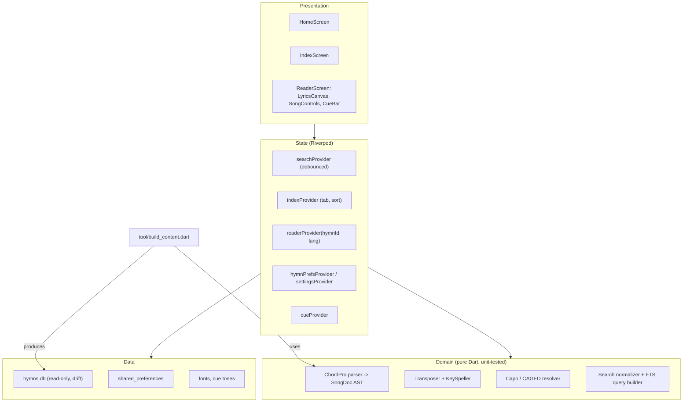

# Bilingual Presbyterian Hymns App — Technical Architecture (v2)

> **Status:** Revised 2026-10-17. Supersedes the original draft. Product decisions referenced as `D#` live in [01-project-overview.md § Appendix A](01-project-overview.md#appendix-a--decision-log).

## 1. Principles

1. **Offline autonomy** — all content and assets bundled; no runtime network except user-initiated `mailto:`.
2. **Content is data, built at compile time** — hymns are authored as ChordPro files in git and compiled into a read-only SQLite asset by a build tool. The app never writes to the content DB.
3. **User state is separate** — per-hymn key/capo and global settings live outside the content DB so content updates never wipe them (D25).
4. **Chords are visual only** — transposition and capo change displayed chords; the Key CUE follows the current key (D7). (MIDI playback, when added, stays at original key unless decided otherwise.)
5. **Least configuration** — Android first, Flutter defaults, minimal plugins, no native code (D17).

## 2. Stack

| Concern | Choice | Notes |
| :--- | :--- | :--- |
| Framework | Flutter (stable), Dart null-safety | Android target only in v1 |
| State | `flutter_riverpod` (Notifier / AsyncNotifier, no codegen) | |
| Content DB | `drift` + `sqlite3_flutter_libs` | Bundles SQLite with FTS5 |
| Paths | `path_provider` | Copy content DB to app support dir |
| User state | `shared_preferences` | Small key-value; ≤ ~1,000 per-hymn entries |
| Wake lock | `wakelock_plus` | Reader only |
| Email | `url_launcher` (`mailto:`) | Clipboard fallback via `services.Clipboard` |
| App version | `package_info_plus` | For report payload |
| Cue audio | `audioplayers` (low-latency mode) | Plays 12 bundled tone assets |
| Fonts | Space Grotesk, Source Serif 4, Inter — **bundled TTF assets** | No runtime Google Fonts fetch (offline) |
| Build tool | Dart CLI in `tool/` reusing `lib/core` parser | `dart run tool/build_content.dart` |
| CI | GitHub Actions | analyze, test, build content |

Deferred to MIDI phase: SoundFont, synthesizer, MIDI sequencer, PCM output plugin.

## 3. Layers



Directory layout:

```
content/            # authored source (ChordPro)
  en/001.cho … 520.cho
  tl/001.cho …      # sparse
  extra/en/<slug>.cho, extra/tl/<slug>.cho   # unnumbered
tool/build_content.dart
assets/db/hymns.db  # generated, committed or built in CI
assets/audio/cue/C4.ogg … B4.ogg
assets/fonts/…
lib/app/            # app shell, theme (from DESIGN.md tokens), routing
lib/core/           # domain: chordpro/, music/, search/
lib/data/           # drift db, repositories, prefs
lib/features/home|index|reader/
```

## 4. Content Authoring Format

One ChordPro file per hymn per language. Chords are transcribed **in the hymn's original (concert) key**.

```text
{number: 1}
{title: Holy, Holy, Holy! Lord God Almighty}
{author: Reginald Heber}
{year: 1826}
{tune: NICAEA}
{meter: 11.12.12.10}
{key: Eb}

{start_of_verse: 1}
[Eb]Ho - ly, [Cm]ho - ly, [Ab]ho - [Eb]ly! Lord God Al - [Bb]migh - ty!
{end_of_verse}

{start_of_chorus}
…
{end_of_chorus}

{start_of_ending}
[Ab]A - [Eb]men.
{end_of_ending}
```

Rules:
- Header directives: `number` (omit for unnumbered), `title`, `key` (required); `author`, `translator`, `year`, `tune`, `meter` (optional).
- Sections: `verse: n` (sequential from 1), `chorus` (written **once**, rendered after every verse — D22), `ending` (optional, unlabeled, e.g. Amen).
- Syllable hyphen = ` - ` (space-hyphen-space). A file with no `[chord]` tokens → `has_chords = 0`.
- Key notation: `C, Db, D, Eb, E, F, F#, G, Ab, A, Bb, B`, with `m` suffix for minor (`Em`).
- Tagalog file `{key}` must equal English `{key}` for the same number (D5); may be omitted and inherited.

### 4.1 Content checker (runs inside the build tool; build fails on error)

| Check | Severity |
| :--- | :--- |
| Every `[chord]` parses (root, quality, optional `/bass`) | error |
| Required directives present; `key` valid | error |
| Verse numbers start at 1 and are contiguous | error |
| Numbers unique per language; within 1–520 | error |
| Every Tagalog number has an English counterpart | error |
| Tagalog `key` equals English `key` | error |
| Unnumbered titles unique per language | error |
| Lines with chords but unbalanced `[`/`]` | error |
| Hymn missing chords | info (coverage report) |

Output: `assets/db/hymns.db` + `build/content-report.md` (counts, chord coverage %, warnings).

## 5. Content Database (read-only)

```sql
CREATE TABLE meta (
  key   TEXT PRIMARY KEY,           -- 'content_version', 'built_at', 'schema_version'
  value TEXT NOT NULL
);

CREATE TABLE hymns (                 -- one row per tune / song
  id           INTEGER PRIMARY KEY,
  hymn_number  INTEGER UNIQUE,       -- NULL for unnumbered songs (D4)
  tune_name    TEXT,
  meter        TEXT,
  original_key TEXT NOT NULL         -- shared by EN and TL (D5, D21)
);

CREATE TABLE hymn_texts (            -- one row per language rendition
  id            INTEGER PRIMARY KEY,
  hymn_id       INTEGER NOT NULL REFERENCES hymns(id),
  language      TEXT NOT NULL CHECK (language IN ('EN','TL')),
  title         TEXT NOT NULL,
  sort_title    TEXT NOT NULL,       -- normalized: lowercase, no accents/leading punctuation
  author        TEXT,
  translator    TEXT,
  year          TEXT,
  verse_count   INTEGER NOT NULL,    -- may differ EN vs TL (D5)
  has_chords    INTEGER NOT NULL,
  chordpro_body TEXT NOT NULL,       -- sections only (header stripped)
  lyrics_text   TEXT NOT NULL,       -- plain: chords removed, ' - ' joined, refrain once
  first_line    TEXT NOT NULL,
  UNIQUE (hymn_id, language)
);

CREATE INDEX idx_texts_lang_sort ON hymn_texts(language, sort_title);

CREATE VIRTUAL TABLE hymn_fts USING fts5(
  title, first_line, lyrics_text,
  content='hymn_texts', content_rowid='id',
  tokenize = "unicode61 remove_diacritics 2"
);
-- Populated once by the build tool: INSERT INTO hymn_fts(hymn_fts) VALUES('rebuild');
-- No triggers: the DB is never modified on device.
```

Unnumbered song = `hymns` row with `hymn_number NULL` and exactly one `hymn_texts` row.

### 5.1 Content DB lifecycle
1. On launch, read `meta.content_version` from the bundled asset and from the installed copy in the app-support dir.
2. If missing or different → copy asset over the installed copy (atomic: write temp, rename).
3. Open with drift read-only. User state is untouched (D25).

## 6. User State (`shared_preferences`)

| Key | Type | Scope |
| :--- | :--- | :--- |
| `hymn.<hymnId>.key` | String (e.g. `D`) | Per hymn, shared EN/TL (D5, D15) |
| `hymn.<hymnId>.capo` | int 0–7 | Per hymn |
| `settings.fontSize` | double, default 19 | Global |
| `settings.hideChords` | bool | Global |
| `settings.indexTab` | `all` / `en` / `tl` | Global |
| `settings.indexSort` | `number` / `title` | Global |

`hymnId` is the stable `hymns.id`. **The build tool must assign stable IDs**: numbered hymns `id = hymn_number`; unnumbered songs get `id ≥ 10000`, assigned once and recorded in `content/extra/ids.json` (never reused or renumbered). Changing an ID would orphan saved prefs.

## 7. Search

### 7.1 Pipeline
1. Input stream debounced **150 ms**; trimmed; empty → clear results.
2. `^\d+$` → **numeric exact** (D10):
   ```sql
   SELECT t.* FROM hymn_texts t JOIN hymns h ON h.id = t.hymn_id
   WHERE h.hymn_number = :n;          -- ≤ 1 row per language
   ```
3. Otherwise → **text**:
   - Normalize query: lowercase, strip diacritics, remove punctuation and chord-like `[..]`, collapse spaces.
   - Build FTS query: each token quoted, last token gets prefix `*` (live typing). Example `banal na` → `"banal" "na"*`.
   ```sql
   SELECT t.*, bm25(hymn_fts, 10.0, 5.0, 1.0) AS rank
   FROM hymn_fts JOIN hymn_texts t ON t.id = hymn_fts.rowid
   WHERE hymn_fts MATCH :q
   ORDER BY rank LIMIT 100;
   ```
   - Group by `language` in Dart → `GroupedSearchResults(english, tagalog)`; cap 50 per group, `n matches` shows the group total.
4. Index-screen search reuses the same engine with an extra `language` filter for the active tab.

Hyphen handling: `lyrics_text` is built by joining ` - ` syllables (`Ho - ly` → `Holy`), so `holy` matches. Accent handling: `remove_diacritics 2` on both index and query.

### 7.2 Result model
```dart
class SearchHit { final int hymnId; final int? number; final String lang;
                  final String title; final String firstLine; }
class GroupedSearchResults { final List<SearchHit> english, tagalog;
                             final int englishTotal, tagalogTotal; }
```

## 8. ChordPro Parsing

```dart
class SongDoc { final List<Section> sections; }          // verse/chorus/ending
class Section { final SectionType type; final int? number; final List<Line> lines; }
class Line { final List<ChordLyricPair> pairs; }
class ChordLyricPair { final Chord? chord; final String text; }
class Chord { final int root; final String quality; final int? bass; }  // pitch classes 0–11
```

- Rendering order: for each verse → verse, then chorus (if defined); then ending.
- Chords are stored as **pitch classes**, spelled only at render time → transposition never re-parses strings.
- Renderer: custom widget (no `flutter_chord`). Each pair is laid out as a column (chord above text); line wraps at pair boundaries; a pair whose chord is wider than its text is padded so chords never overlap. Hide-chords renders text only (no reserved chord row).

## 9. Transposition, Spelling & Capo

### 9.1 Definitions
- `originalKey` — from DB.
- `soundingKey` — saved per hymn (default `originalKey`). Offset `t = soundingKey.root − originalKey.root (mod 12)`.
- `capo` — 0–7, saved per hymn.
- `shapeKey` — `soundingKey − capo`. **Displayed chords = each chord shifted by `t − capo`, spelled for `shapeKey`** (D8).

Example: original C, sounding C, capo 3 → shapeKey A → `[C]` displays **A** (D8).

### 9.2 Key spelling table (D13)

| Pitch | Major key name | Minor key name | Accidentals |
| :--- | :--- | :--- | :--- |
| 0 | C | Cm | C: sharps · Cm: flats |
| 1 | Db | C#m | Db: flats · C#m: sharps |
| 2 | D | Dm | D: sharps · Dm: flats |
| 3 | Eb | Ebm | flats |
| 4 | E | Em | sharps |
| 5 | F | Fm | flats |
| 6 | F# | F#m | sharps |
| 7 | G | Gm | G: sharps · Gm: flats |
| 8 | Ab | G#m | Ab: flats · G#m: sharps |
| 9 | A | Am | sharps (Am: naturals → sharps) |
| 10 | Bb | Bbm | flats |
| 11 | B | Bm | sharps |

Chord roots **and slash-bass notes** are spelled with the target key's accidental preference: sharps → `C C# D D# E F F# G G# A A# B`; flats → `C Db D Eb E F Gb G Ab A Bb B`.

### 9.3 Key controls
- `[-1]/[+1]` shift `soundingKey` by one semitone (mode preserved). `[Key ▾]` lists the 12 keys of the same mode.
- `Reset` → `soundingKey = originalKey`, `capo = 0`.
- Capo is **unchanged** by transposition; `shapeKey` recomputes (D8).

### 9.4 CAGED resolver
```
capoFor(shape) = (soundingKey.root − shapeRoot(shape)) mod 12     // C=0, A=9, G=7, E=4, D=2
enabled(shape) = capoFor(shape) <= 7
active(shape)  = shapeKey.root == shapeRoot(shape)
```
Tapping an enabled shape sets `capo = capoFor(shape)`. For minor keys the same root comparison applies (e.g., Am-shape).

## 10. Key CUE (D7, D20)

- Assets: 12 pre-rendered tones `C4…B4` (≈2 s, organ-like additive synthesis, exponential decay, 44.1 kHz mono OGG), generated once by `tool/render_cue_tones.dart`. ≈ 0.3 MB total.
- `cueKey` defaults to `soundingKey` and follows it while untouched. Tonic = key root (minor → minor tonic, e.g., `Em` → E4).
- Changing `cueKey` to differ from `soundingKey` → confirmation dialog: *"Cue in F while chords are in Eb?"* `[Cancel] [Use F]`.
- `cueKey` is ephemeral (reader-scoped provider; reset when the reader closes).
- Tap while playing → restart. Leaving the reader → stop + dispose player.

## 11. Report a Problem (D16)

```
mailto:<REPORT_EMAIL>?subject=[Hymns] EN #1 – Holy, Holy, Holy&body=
Hymn: EN #1 – Holy, Holy, Holy! Lord God Almighty
Key: D (original Eb) · Capo: 0
App: 1.0.0+12 · Content: 2026.10.17-3
---
Describe the problem:
```
- `REPORT_EMAIL` via `--dart-define=REPORT_EMAIL=…` (not hard-coded in source).
- Values URL-encoded. If `launchUrl` returns false → copy body to clipboard + snackbar showing address.

## 12. State (Riverpod)

| Provider | Kind | Holds |
| :--- | :--- | :--- |
| `contentDbProvider` | FutureProvider | Opened drift DB after lifecycle check |
| `searchProvider` | Notifier | query, debounced results |
| `indexProvider` | Notifier | tab, sort, list |
| `readerProvider(hymnId, lang)` | AsyncNotifier.family | parsed `SongDoc`, metadata, counterpart availability |
| `hymnPrefsProvider(hymnId)` | Notifier.family | soundingKey, capo (persisted) |
| `settingsProvider` | Notifier | fontSize, hideChords, index tab/sort |
| `cueProvider` | Notifier (autoDispose) | cueKey, isPlaying |

Rebuild isolation: `LyricsCanvas` watches only `SongDoc`, display offset, `shapeKey` spelling, fontSize, hideChords. Cue state never rebuilds the canvas.

## 13. Platform

- Android `applicationId`: `com.badzbordz.hymns` (personal/private project namespace). Default Flutter minSdk.
- Source ingest: Google Docs exported as text / markdown / docx, ingested by `tool/import_gdoc.dart` into `.cho` files during M0.
- Simulation: local Android Emulator with 2 GB RAM profile to benchmark cold start (<1.5s) and search (<50ms).
- Build: `flutter build apk --release --split-per-abi --dart-define=REPORT_EMAIL=…`.
- Distribution: Firebase App Distribution via CLI (no Firebase SDK in the app).
- Signing: release keystore stored outside the repo; backed up.

## 14. Resource Budget

| Asset | Size |
| :--- | :--- |
| Content DB (~900 texts + FTS) | ~3–4 MB |
| Fonts (3 families, needed weights) | ~1.5 MB |
| Cue tones | ~0.3 MB |
| Flutter engine + app code (per ABI) | ~9–11 MB |
| **APK per ABI** | **< 25 MB** |

## 15. Testing

| Layer | Tests |
| :--- | :--- |
| ChordPro parser | sections, refrain expansion, ending, hyphens, malformed input |
| Transposer / speller | all 12 keys × major/minor, slash chords, round-trip ±12 |
| Capo / CAGED | shape display, disabled > 7, active state, capo fixed on transpose |
| Search | normalizer (accents, hyphens, chords), query builder, numeric exact; drift in-memory FTS test |
| Content checker | one fixture per rule |
| Manual checklist | per milestone (see plan) |

CI (GitHub Actions): `flutter analyze` → `flutter test` → `dart run tool/build_content.dart` (fails on content errors).
