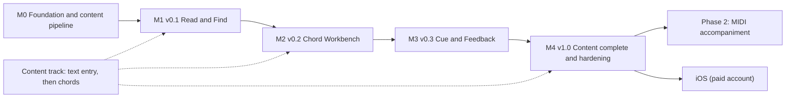

# Bilingual Presbyterian Hymns App — Implementation Plan (v2)

> **Status:** Revised 2026-10-17. Replaces the 8-week, 4-phase plan. Scheduling is by **release milestone**, not calendar week — content transcription pace (single developer) drives the timeline.
> Specs: [01-project-overview.md](01-project-overview.md) · [02-technical-architecture.md](02-technical-architecture.md) · [04-design-alignment.md](04-design-alignment.md)

## 1. Roadmap

| Milestone | Release | Ships to users? | Exit gate |
| :--- | :--- | :--- | :--- |
| M0 | — | No | Pipeline builds DB from ≥ 20 sample hymns; CI green |
| M1 | v0.1 | Yes (internal testers) | Search, Index, Reader (text) on reference device |
| M2 | v0.2 | Yes | Chords, transposition, capo/CAGED, saved per hymn |
| M3 | v0.3 | Yes | Key CUE + Report a problem |
| M4 | v1.0 | Yes | All 900 texts in; checker clean; NFRs met |

Each release = APK via Firebase App Distribution with release notes.

## 2. Content Track (runs in parallel)

| Step | Output | Needed by |
| :--- | :--- | :--- |
| C1 Convert existing text to `.cho` (EN + TL), header metadata incl. **key** for every hymn | `content/en`, `content/tl` | M1 (≥ sample), M4 (all) |
| C2 Add verse/chorus/ending markers | same files | M1 for shipped hymns |
| C3 Transcribe chords (concert key), prioritising most-sung hymns | same files, `has_chords` ↑ | M2 onward, progressive |
| C4 Unnumbered songs + `extra/ids.json` | `content/extra` | Any time |
| C5 Proofread against printed books | coverage report sign-off | M4 |

Track progress with `build/content-report.md` (counts, chord coverage %).

> [!IMPORTANT]
> **Open input:** what format is the current text in (Word, PDF, spreadsheet, plain text)? If structured, write a one-off converter in `tool/` during M0; if PDF/scan, budget manual cleanup.

## 3. M0 — Foundation & Content Pipeline

**Tasks**
- Flutter project, strict lints (`flutter_lints` + `strict-casts`, `strict-raw-types`), layout per architecture §3.
- Dependencies: `flutter_riverpod`, `drift`, `sqlite3_flutter_libs`, `path_provider`, `shared_preferences`; dev: `drift_dev`, `build_runner`.
- Theme from [design/DESIGN.md](design/DESIGN.md) tokens; bundle Space Grotesk, Source Serif 4, Inter.
- Domain: ChordPro parser + `SongDoc` AST (architecture §8).
- `tool/build_content.dart`: parse → checker (§4.1) → write `hymns.db` (stable IDs, `lyrics_text`, `sort_title`, FTS rebuild, `meta.content_version`) → `content-report.md`.
- Sample content: ≥ 20 hymns covering: EN+TL pair, EN-only, different verse counts, chorus, ending, minor key, slash chord, no-chords, 2 unnumbered (EN, TL).
- CI: analyze, test, build content.

**Acceptance**
- `dart run tool/build_content.dart` produces DB; deliberately broken fixture fails the build with a file:line message.
- Parser + checker unit tests pass.

## 4. M1 — v0.1 "Read & Find"

**Tasks**
- Content DB lifecycle (copy-on-version-change, architecture §5.1).
- Search engine: normalizer, numeric exact, FTS query, grouping.
- Home: hero, search dropdown, catalog cards (counts from DB).
- Index: tabs, Number/Title sort, A–Z rail (Title only), sparse Tagalog, unnumbered at end, in-tab search, availability + key badges.
- Reader (text only): metadata, verses/chorus/ending rendering, language switch + scroll reset + canvas tint, empty state, unnumbered (no switcher), font size (global, persisted), wake lock.
- Settings persistence (font size, index tab/sort).
- Firebase App Distribution set-up; signing keystore.

**Acceptance**
1. Typing `1` shows exactly EN #1 and TL #1; `600` shows an empty state.
2. Typing `holy`, `Holy`, and `banal` find hymns whose source has `Ho - ly` / `Ba - nal`; `diyos` matches `Diyós` if present.
3. Search ≤ 50 ms p95 on reference device (measured via debug timer over 50 queries).
4. Tagalog tab shows no placeholder for missing numbers; All tab marks `EN ONLY`.
5. Number sort: numbered ascending then unnumbered A→Z; A–Z rail hidden. Title sort: rail visible and jumps correctly.
6. Reader: switching to a missing Tagalog shows empty state; its button returns to English at top.
7. Font size persists across restarts; range 12–28 without horizontal clipping on a 360 dp-wide screen.
8. Screen does not sleep in Reader after the device timeout; does sleep on Home.
9. Cold start < 1.5 s (second launch) on reference device.
10. Airplane mode: all of the above work.

## 5. M2 — v0.2 "Chord Workbench"

**Tasks**
- Chord renderer widget (chord-above-syllable, wrap at pair boundaries, no overlap); hide-chords mode.
- Transposer + key speller (major/minor, slash chords) — architecture §9.
- Song Controls card: key `[-1] [Key ▾] [+1]` + Reset, size, hide chords, capo 0–7, CAGED; collapsed summary `Capo n • Key X`; Size-only variant for no-chord hymns.
- Per-hymn persistence (`hymn.<id>.key`, `hymn.<id>.capo`) shared EN/TL.
- Key badge in reader header shows **sounding key**; when capo > 0 also show `Capo n · shapes in Y`.

**Acceptance**
1. Unit tests: 12 keys × 2 modes spelled per table; `D/F#` +1 → `Eb/G`; transposing +12 returns identical output.
2. Original C, capo 3 → chords display as A-shapes; header shows Key C, `Capo 3 · shapes in A`.
3. With capo 3, transposing +2 keeps capo 3; shapes become B.
4. CAGED buttons needing capo > 7 are disabled; tapping an enabled one sets the capo and highlights it.
5. Close and reopen the hymn (and switch EN↔TL): key and capo restored. Reset restores original key, capo 0.
6. Hide chords persists globally; no blank chord rows when hidden.
7. Chords never overlap on 320–412 dp widths at 12, 19 and 28 px.
8. Transpose tap → repaint with no dropped frames in Flutter DevTools on reference device.

## 6. M3 — v0.3 "Cue & Feedback"

**Tasks**
- `tool/render_cue_tones.dart` → 12 OGG tones (C4–B4); add `audioplayers`.
- Cue bar (docked bottom): `[♪ <key> Cue]`, key picker, confirmation dialog when cue key ≠ sounding key; stop on leaving reader.
- Report a problem: overflow menu → `mailto:` with pre-filled payload; clipboard fallback; `REPORT_EMAIL` via `--dart-define`. Add `url_launcher`, `package_info_plus`.

**Acceptance**
1. Cue plays the tonic of the current sounding key within 150 ms of tap; minor key → minor tonic.
2. Transposing updates the cue label; picking a different cue key shows the confirm dialog; Cancel keeps the previous cue key.
3. Leaving the reader stops sound immediately; reopening resets cue to sounding key.
4. Report opens the mail app with correct hymn, language, key, capo, app and content version; with no mail app, payload is on clipboard and address shown.

## 7. M4 — v1.0 "Content Complete & Hardening"

**Tasks**
- Content C1–C2, C5 complete for all 520 EN + 380 TL; C3 progressive (no chord-coverage gate for v1).
- Performance pass on reference device: cold start, search p95, reader scroll at 28 px.
- Accessibility: lyrics contrast ≥ 7:1 on both canvases; UI ≥ 4.5:1 (see design alignment for gold colour fix); TalkBack labels on controls.
- Tablet / landscape smoke test (no broken layouts).
- Release notes, version bump, final APK.

**Acceptance**
1. Checker: 0 errors; report shows 520 EN / 380 TL.
2. Proofreading checklist signed off (single reviewer, recorded in `docs/qa/content-signoff.md`).
3. All NFRs in overview §7 met on the named reference device.
4. 30-minute session (search, read, transpose, cue, switch language repeatedly) without crash or visible memory growth in DevTools.

## 8. Phase 2 (post-v1) — MIDI Accompaniment (outline only)

Re-plan when started. Known prerequisites: MIDI file source per tune, SoundFont pruning, synthesizer (`dart_melty_soundfont`) **plus** a MIDI sequencer and PCM output plugin, verse markers per language (verse counts differ EN/TL), playback stops on leaving reader (D9), decision on whether playback follows transposition.

## 9. Risks

| Risk | Severity | Mitigation |
| :--- | :--- | :--- |
| Content transcription throughput (900 texts + chords, one person) | **High** | Ship v0.1 with partial catalog; prioritise most-used hymns; checker + coverage report |
| Source text format is messy (PDF/scan) | High | Identify format in M0; converter or manual cleanup budget |
| Chord layout wrapping on narrow screens | Medium | Custom renderer from start; widget tests at 320 dp |
| Saved prefs orphaned by ID changes | Medium | Stable IDs (`id = number`, `extra/ids.json`); checker rejects ID reuse |
| Content DB update wipes user data | Medium | User state in `shared_preferences`, never in content DB |
| Cue latency on low-end Android | Low | Low-latency player mode; preload tones on reader open |
| iOS demand before paid account | Low | Communicate Android-only v1 |
| Copyright if app goes public later | Low (internal) | Re-assess before any public distribution |

## 10. Working Agreement (Antigravity / solo dev)

- Generate and merge **one milestone at a time**; next milestone starts only when the current exit gate passes.
- Domain code (`lib/core`) is written test-first; UI wired after domain tests pass.
- `LyricsCanvas` never watches cue or (future) player providers — pass primitives only.
- Every content change goes through `build_content` in CI; no hand-edited DB.
- Reference device: **TBD — name a specific low-end 2 GB Android phone before M1.**
